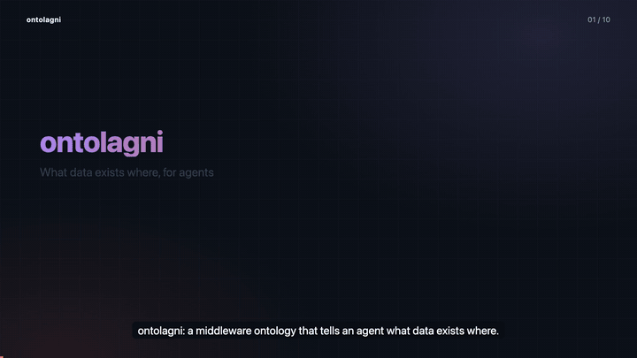
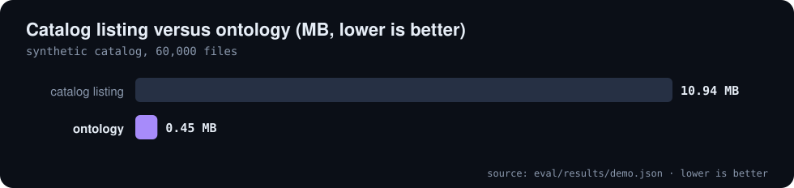
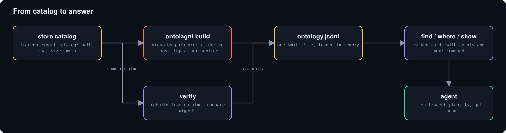

<div align="center">



# 🧭 ontolagni

**Middleware ontology: what data exists where. JSON for agents, pointers into traceDB**

    [](https://github.com/Bobliuuu/ontolagni/releases/tag/v0.2.1) [](https://github.com/Bobliuuu/traceDB)

[🎬 Video](#video) · [🚀 Quick use](#quick-use) · [📊 Demo numbers](#demo-numbers) · [🧩 How it works](#how-it-works) · [⌨️ Commands](#commands) · [⚠️ Caveats](#caveats) · [🗺️ Repo map](#repo-map)

</div>

---

**Explainer video (with voice-over and subtitles): the problem, the idea, and a reproducible demo benchmark**

[](video/ontolagni_explainer.mp4)

<a id="video"></a>
**ontolagni** answers one question for an agent: **what data exists where?** It turns a catalog listing (`{path, sha, size, meta}` per file, as produced by
`tracedb export-catalog`) into a small ontology of nodes: roots, campaigns and sub-groups, each with file and byte counts, formats, tags derived from the
names (model, chip, date, project) and a **content digest of its whole subtree**. Output is JSON for agents, not prose for humans.
It is siloed: standard library only, nothing imported from traceDB; the only contract is the catalog file format.

<a id="quick-use"></a>

## 🚀 Quick use

```bash
tracedb export-catalog --out cat.jsonl && ontolagni build cat.jsonl
ontolagni find qwen g7e vllm            # ranked nodes, each with file/byte counts and the next tracedb command
ontolagni where logs/x/y/z.log          # owner chain
ontolagni verify cat.jsonl              # exit 2 if anything drifted
```
Agents: ontolagni (find) → `tracedb plan`/`ls`/`get --head` (budgeted). Never pull blind.

<a id="demo-numbers"></a>

## 📊 Demo numbers

Produced by [`eval/demo_bench.py`](eval/demo_bench.py) into [`eval/results/demo.json`](eval/results/demo.json). The catalog is **synthetic** (generated deterministically by the script), so these numbers show the mechanics of build, find and verify, not ranking quality on a real store.

| Files in demo catalog | Nodes | Ontology vs catalog size | find p50 | Build time | Load time |
|:---:|:---:|:---:|:---:|:---:|:---:|
| **60,000** | **903** | **25x** | **0.33 ms** | **0.4 s** | **10 ms** |

**Demo benchmark on a synthetic catalog (eval/demo_bench.py)**

| Artifact | Size |
| :--- | ---: |
| catalog listing | 10.94 MB |
| ontology | 0.45 MB |

<sub>Source: `eval/results/demo.json`</sub>

<p align="center"></p>

<p align="center"></p>

Changing one file's hash in the catalog makes `verify` flag exactly the 4 nodes on its path (root to group); the unmodified catalog verifies clean.

<a id="how-it-works"></a>

## 🧩 How it works

Nothing is invented: every field is derived from the catalog's paths and meta; absent means omitted. Nodes exist at depth 1 (root), 2 (campaign or dataset) and 3 to 4 (sub-groups, `--max-depth`). Each node carries a digest over its subtree.

<p align="center"></p>

<details>
<summary>What a node carries</summary>

File and byte counts (blob pointers count at their real size), format counts, top JSON keys, first and last modification time, and tags derived from the group name: kind, project or source, model, chip, topic, date. `--describe` merges README-derived summaries verbatim.

</details>

<details>
<summary>Box-access nodes</summary>

`ontolagni build --ssh-config` turns an ssh config into `boxes/<alias>` nodes (alias, provider hints, docs that mention it). Private keys are never read; only the IdentityFile path is recorded.

</details>

<a id="commands"></a>

## ⌨️ Commands

**Commands**

| Command | What it does |
| :--- | :--- |
| `ontolagni build <catalog.jsonl>` | derive the ontology (nodes, digests, tags); `--ssh-config` adds box-access nodes |
| `ontolagni find <words>` | ranked nodes with counts and the next tracedb command; filters `--kind --model --chip --campaign --depth` |
| `ontolagni where <path>` | owner chain of a path |
| `ontolagni show <id>` | one node card |
| `ontolagni verify <catalog.jsonl>` | rebuild and compare every digest; exit 2 on drift |
| `ontolagni render` / `wiki --out DIR` | human ONTOLOGY.md, agent AGENT.md + agent_index.json, or a static HTML wiki (IP-like strings masked) |

<a id="quick-start"></a>

## 🚀 Quick start

**Reproduce the demo and rebuild this README**

```bash
python3 eval/demo_bench.py
python3 ~/video-readme-maker/vrm.py all README.spec.yml
```

<a id="caveats"></a>

## ⚠️ Honest caveats

- The demo benchmark uses a synthetic catalog: it measures build, find and verify mechanics, not ranking quality on a real store.
- The real-catalog ranking evaluation (`eval/rank_metrics.py`) needs inputs that are not in this repository, so no ranking numbers are claimed.
- The ontology is only as informative as the paths, names and meta in the catalog.

<a id="repo-map"></a>

## 🗺️ Repo map

| Path | What it is |
|---|---|
| `ontolagni/` | library and CLI: build, query (find, where, show, verify), render, wiki, access (box nodes) |
| `tests/` | pytest suite for the ontology and box-access nodes |
| `eval/demo_bench.py` | deterministic synthetic benchmark; writes eval/results/demo.json |
| `eval/rank_metrics.py` | ranking metrics (MRR, hit@k) for a real catalog snapshot |
| `README.spec.yml` | drives the README and the video |
| `video/` | explainer mp4, poster, preview gif, subtitles |
| `assets/` | generated hero, chart and diagram SVGs |

---

<div align="center"><sub>Generated with [video-readme-maker](https://github.com/Bobliuuu/video-readme-maker).</sub></div>
